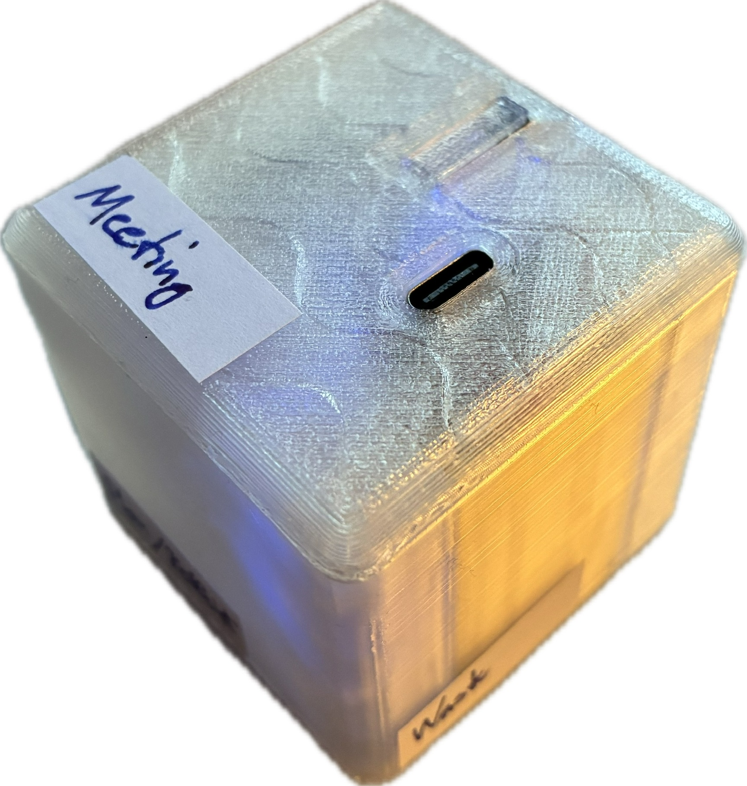
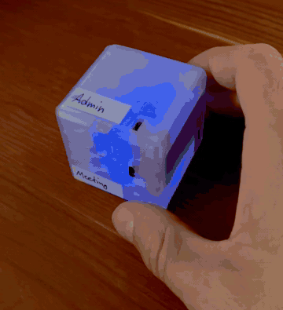

# Time Cube — a physical time tracker (ESP32-S3)


> **Work in progress.** The core features work. A few are still waiting for real-world verification (see [Status](#status)).

**Ever wonder where your whole working day went? And whether you spend your time on the things you actually want to?**

Time Cube is a small DIY cube that answers that without making tracking a job of its own. Each face stands for an activity: flip the cube and it starts tracking that activity. At the end of the day, week or month you can compare your plan with reality: how much focus time did you really get, and how much went to meetings or admin?

It needs no app, no cloud and no phone. Everything is stored on the device and can be viewed or exported through its local web interface.

## Contents

- [Features](#features)
- [Using the cube](#using-the-cube)
- [Hardware](#hardware)
- [Getting started](#getting-started)
- [Configuration](#configuration)
- [Software internals](#software-internals)
- [Status](#status)

---

## Features

- **Orientation-based tracking** - Each of the 6 faces is one activity.
- **Breaks** - Put the cube on a corner, or double-click the button, to log a break ("Pause").
- **Button control** - A single click resumes tracking, a double click starts a break, and holding the button toggles WiFi.
- **Tracking reminder** - A short orange blink every X minutes (defined in the web UI) shows that tracking is running.
- **Auto-stop** - Tracking ends on its own after X hours (defined in the web UI) on one face, so a forgotten cube doesn't log the whole night.
- **Long-term local storage** - A ring buffer holds about 88,000 entries, roughly 4 years at a 25-minute average session.
- **Power-loss protection** - An unfinished session is recovered after a reboot, losing at most about 60 s.
- **Built-in analytics** - The cube serves its own `/analytics` page with pie charts, a monthly breakdown and a daily view, and the option to download the data as csv.
- **Standalone and open source** - It runs on your local network and can be fully customised through ESPHome.



---

## Using the cube

| Action                         | Result                                                                    |
| ------------------------------ | ------------------------------------------------------------------------- |
| Flip to a face (1–6)           | After 2 s on the new face, the previous session is logged and the new one starts |
| Put on a corner                | Starts a break (no axis is clearly up)                                    |
| **Double click**               | Starts a break without moving the cube                                    |
| **Single click**               | Ends a break, or restarts tracking after auto-stop, on the face that is up |
| **Hold ≥ 3 s**                 | Turns WiFi on or off                                                      |

**Tip for double-click breaks:** for 15 s after the double click you can still pick up the cube and put it down on any face, and the break keeps going (turquoise blink). After that, flipping to a new face or clicking once ends the break.

### LED states

Listed in priority order: the first state that applies is shown.

| State                          | Color     | Pattern                  |
| ------------------------------ | --------- | ------------------------ |
| Booting / WiFi never connected | Yellow    | Slow blink               |
| WiFi connection lost           | Red       | Fast blink               |
| New face confirmed             | Green     | Solid for 5 s            |
| Face change detected (debounce)| White     | Dim solid                |
| Stopped by the time limit      | Purple    | Dim solid                |
| On a break                     | Turquoise | Slow, soft pulse         |
| WiFi turned off with the button | —        | Off (only when none of the states above apply) |
| Tracking / idle                | Blue      | Solid (brightness configurable) |

The yellow and red WiFi blinks only show while WiFi is enabled. With WiFi turned off, the LED still shows all tracking states and goes dark only when idle.

Short one-off flashes:

| Event                          | Color     |
| ------------------------------ | --------- |
| Break started / cube put down during a break | Turquoise blink |
| Tracking reminder              | Orange blink |

---

## Hardware

| Component    | Specification                                  |
| ------------ | ---------------------------------------------- |
| MCU          | ESP32-S3 SuperMini (4 MB flash) |
| IMU          | MPU-6050 (I2C)                                 |
| LED          | Onboard WS2812B (GPIO 48)                      |
| Button       | Momentary push button                          |
| Battery      | LiPo 400–500 mAh, TP4056 charging circuit      |
| Power switch | Slide switch                                   |
| Enclosure    | 3D-printed, ~5×5×5 cm, translucent PLA         |

The enclosure files are in [3D_files/](3D_files/). Assembly notes are in [buildguide.md](buildguide.md).

### Cost and what you need

About **€15 per cube** when ordered from AliExpress. The LiPo is usually sold with the TP4056 charger board already attached, and the button and slide switch cost very little.

To build one you need a 3D printer, a soldering iron, the parts above and a USB cable: print the case, solder the IMU, button, battery and charger to the ESP32-S3, then flash the ESPHome firmware.

### Wiring

| Connection    | ESP32-S3 pin |
| ------------- | ------------ |
| MPU-6050 SDA  | GPIO 8       |
| MPU-6050 SCL  | GPIO 9       |
| MPU-6050 VCC  | 3.3 V        |
| MPU-6050 GND  | GND          |
| Button        | GPIO 13 ↔ GND (internal pull-up) |

> If your wiring is different, adjust the pins in [timecube.yaml](ESPHome_config/timecube.yaml).

---

## Getting started

### 1. Flash the firmware

The easiest way is the browser installer:

1. Connect the cube via USB.
2. Open [web.esphome.io](https://web.esphome.io/?dashboard_install).
3. Select the device and flash the firmware built from [ESPHome_config/](ESPHome_config/).

Or use the ESPHome CLI:

```sh
# one-time install in a separate virtualenv
python3 -m venv ~/.venvs/esphome
source ~/.venvs/esphome/bin/activate
pip install esphome

# sanity check: compile only, no device needed
esphome compile /Path.../ESPHome_config/timecube.yaml

# compile and flash over USB (asks for the serial port)
esphome run /Path.../ESPHome_config/timecube.yaml

# follow the device logs
esphome logs /Path.../ESPHome_config/timecube.yaml
```

OTA is disabled, so firmware updates are done over USB only.

### 2. Connect to WiFi

1. Turn the cube on. The LED blinks yellow.
2. Connect your phone or laptop to the **TimeCube Setup** hotspot (no password).
3. Follow the captive portal to join your WiFi. Setup over USB with Improv Serial also works.
4. The time is synced over NTP automatically once the cube is connected. The LED turns blue.

To find the cube's IP address if `timecube.local` doesn't resolve, open the device logs (USB + [web.esphome.io](https://web.esphome.io/?dashboard_install)). The IP is printed after the WiFi connects.

### 3. Track your time

1. Open `http://timecube.local` and name each face (fields "Seite 1 Name" to "Seite 6 Name").
2. Flip the cube to start tracking.
3. View your data at `http://timecube.local/analytics`.

---

## Configuration

All settings are in the web interface at `http://timecube.local` and are kept across reboots.

| Setting                                | Default | Range     | Description                                         |
| -------------------------------------- | ------- | --------- | --------------------------------------------------- |
| Seite 1–6 Name                         | —       | text      | Activity name for each face                         |
| Erinnerung alle Minuten (0 = aus)      | 30      | 0–240 min | Interval of the orange reminder blink               |
| Max. Tracking Stunden                  | 4       | 1–24 h    | Auto-stop after this many hours on one face         |
| WLAN LED Helligkeit                    | 20 %    | 1–100 %   | Brightness of the blue idle LED                     |
| Entprellzeit                           | 1 s     | 0.2–10 s  | How long a face must stay up before a change is confirmed |
| Pause Karenzzeit                       | 15 s    | 1–120 s   | Time after a double click during which the cube can be put down without ending the break |
| Pause LED Rot / Gruen / Blau           | 0 / 100 / 80 % | 0–100 % | LED color for breaks (default turquoise)     |
| Pause LED Helligkeit                   | 18 %    | 1–100 %   | Peak brightness of the break pulse (minimum is 1/6 of it) |

Buttons in the web interface: **Restart**, **CSV Aktualisieren** (refresh the export), **Log Loeschen** (clear all logs) and **WiFi Reset (Factory Reset)**.

---

## Software internals

The firmware is built with [ESPHome](https://esphome.io/) (2025.5.2, esp-idf framework).

| File                                                             | Purpose                                         |
| ---------------------------------------------------------------- | ----------------------------------------------- |
| [timecube.yaml](ESPHome_config/timecube.yaml)                    | Main configuration: sensors, button, LED, tracking logic |
| [timecube_storage.h](ESPHome_config/timecube_storage.h)          | Log ring buffer, activity names, checkpoints    |
| [timecube_dashboard.h](ESPHome_config/timecube_dashboard.h)      | Embedded analytics page served at `/analytics`  |
| [partitions_timecube.csv](ESPHome_config/partitions_timecube.csv)| Flash partition table                           |
| [index.html](index.html)                                         | Source of the analytics page (keep in sync with `timecube_dashboard.h`) |

### Storage

- Each log entry is 32 bytes, stored in a dedicated flash partition (`tclog`, ~2.7 MB).
- The ring buffer is persistent: the write head and wrap flag are kept in NVS. It survives reboots and overwrites the oldest entries when full.
- Entry format: `timestamp, face, activity, duration_sec`. Breaks are logged as face 0 ("Pause").

### Power-loss protection

- While a session is active, a checkpoint (face, session start, last-seen time) is saved to NVS every 60 s.
- On the first NTP sync after boot, `recover_checkpoint()` logs any unfinished session up to its last checkpoint.

### Web endpoints

| URL                                          | Content                                               |
| -------------------------------------------- | ----------------------------------------------------- |
| `http://timecube.local/`                     | Standard ESPHome device page (served locally, works offline) |
| `http://timecube.local/analytics`            | Analytics dashboard, reads the CSV export automatically |
| `http://timecube.local/text_sensor/csv_export` | CSV export of the most recent entries (max. 16 KB per response) |

The Home Assistant API also provides the services `set_activity_name`, `export_csv` and `clear_log`.

---

## Status

### Verified

- Compiles cleanly with ESPHome 2025.5.2 (esp-idf).
- Flipping the cube logs entries correctly (`Logged [n/88064]: Seite X | N s`).
- Breaks on a corner, single and double click, reminder blink and auto-stop.
- `/analytics` loads quickly and shows real CSV data.
- `/` loads quickly with `local: true`.

### Not yet verified

- **Power-loss recovery.** This needs a real power cut. Test: flip to a face, wait more than 60 s, cut power, restore it, wait for WiFi/NTP, then look in the logs for `Wiederhergestellt nach Stromverlust`. The recovered entry should appear in `/analytics`.
- **WiFi toggle by holding the button.** It is implemented but not fully tested.
- **Ring buffer wrap-around.** Not tested, because filling 88,064 entries would take years.

### Known issues

- When several clients connect at once (for example several browser tabs plus the VS Code extension), `/events` (the live-update stream of the device page) sometimes fails with `net::ERR_CONNECTION_RESET`. The likely cause is the small limit on concurrent sockets in the ESP32 httpd. The browser reconnects automatically, so this is cosmetic.

---

## License

MIT
